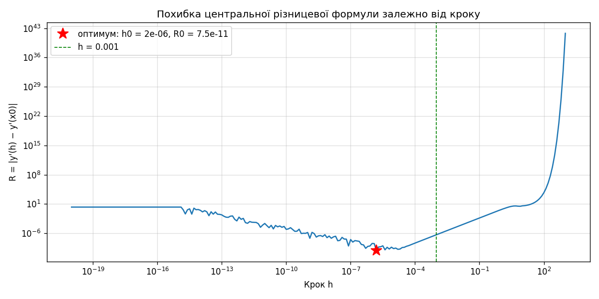
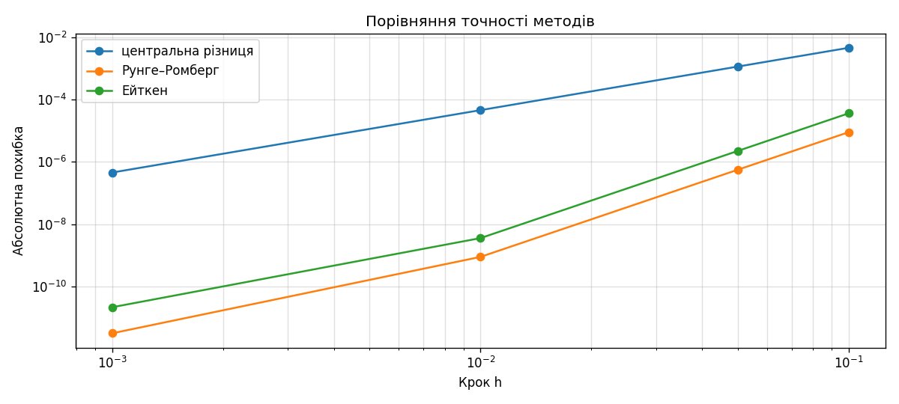

# Лабораторна робота №4

**Тема:** Точність формул для чисельного диференціювання. Метод Рунге–Ромберга. Метод Ейткена

**Задача:** вологість ґрунту M(t) = 50e^(−0.1t) + 5 sin t; знайти швидкість її зміни M′(t) у точці t₀ = 1
чисельно та підвищити точність методами Рунге–Ромберга й Ейткена.

Програма: [`main.py`](main.py), повний вивід — [`console_output.txt`](console_output.txt),
похибка для 231 значення кроку — [`errors.txt`](errors.txt).

## Результати

- Точна похідна: M′(t) = −5e^(−0.1t) + 5 cos t, **M′(1) = −1.822675560839**.
- Центральна різниця y′(h) = (f(x₀+h) − f(x₀−h)) / 2h, порядок O(h²).
- Оптимальний крок **h₀ = 2e−06**, похибка R₀ = 7.53e−11. При більших h переважає похибка методу (∼h²),
  при менших — похибка округлення (∼Δ/h).

Для h = 10⁻³:

| Метод | Значення | Похибка |
|-------|----------|---------|
| Центральна різниця, h | −1.822676018634 | R₁ = 4.58e−7 |
| Рунге–Ромберг (h, 2h) | −1.822675560842 | R₂ = 3.20e−12 |
| Ейткен (h, 2h, 4h) | −1.822675560861 | R₃ = 2.19e−11 |

Оцінка порядку точності за Ейткеном: **p = 2.0000**.

| h | R₁ | R₂ (Р–Р) | R₃ (Ейткен) | p |
|---|----|----------|-------------|---|
| 0.1   | 4.58e−3 | 8.99e−6  | 3.62e−5  | 1.9893 |
| 0.05  | 1.14e−3 | 5.63e−7  | 2.25e−6  | 1.9973 |
| 0.01  | 4.58e−5 | 9.00e−10 | 3.60e−9  | 1.9999 |
| 0.001 | 4.58e−7 | 3.20e−12 | 2.19e−11 | 2.0000 |

## Висновок

Похибка центральної формули спадає як h², уточнені значення — приблизно як h⁴, бо методи
Рунге–Ромберга та Ейткена виключають головний член похибки. Уточнення дає точність, недосяжну для
самої різницевої формули при будь-якому кроці.
