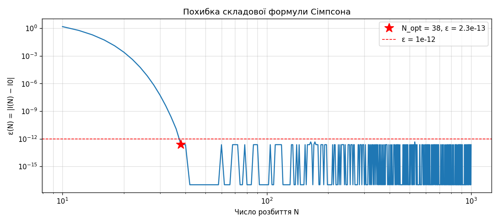
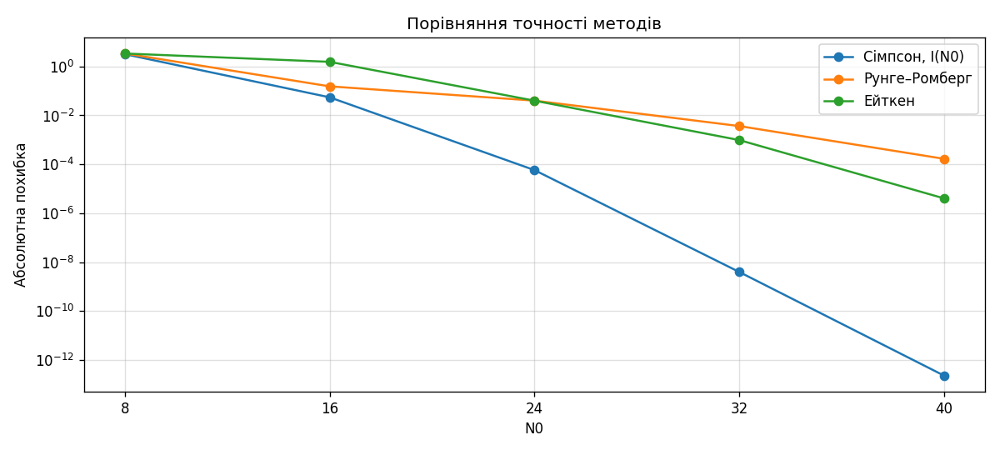
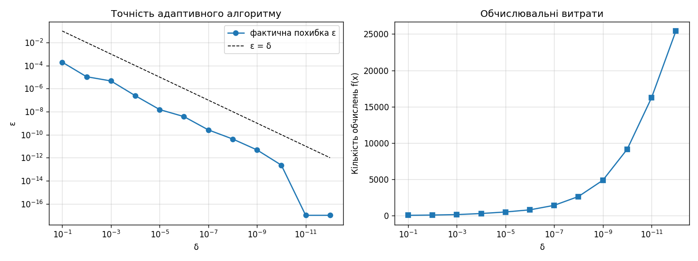

# Лабораторна робота №5

**Тема:** Складова квадратурна формула для чисельного інтегрування. Методи підвищення точності. Адаптивний алгоритм

**Задача:** накопичене навантаження на сервер I = ∫₀²⁴ f(x) dx,
f(x) = 50 + 20 sin(πx/12) + 5 exp(−0.2 (x − 12)²).

Програма: [`main.py`](main.py), повний вивід — [`console_output.txt`](console_output.txt).

## Результати

- Точне значення: I₀ = 1200 + 5√(5π)·erf(12/√5) = **1219.816636488029**.
- Складова формула Сімпсона: точність 1e−12 досягається вже при **N_opt = 38** (ε = 2.27e−13).
  Похибка спадає експоненційно, бо на [0; 24] функція практично періодична
  (повний період синуса, гауссова складова на кінцях ≈ 1.6e−12).

- N₀ = 8 (≈ N_opt/10, кратне 8): eps0 = 3.19, Рунге–Ромберг epsR = 3.42, Ейткен epsE = 3.40, p = 4.13.

| N₀ | eps0 | epsR | epsE | p |
|----|------|------|------|---|
| 8  | 3.19    | 3.42    | 3.40    | 4.13 |
| 16 | 5.49e−2 | 1.54e−1 | 1.55    | 0.13 |
| 24 | 5.79e−5 | 4.02e−2 | 4.00e−2 | 3.82 |
| 32 | 3.94e−9 | 3.66e−3 | 9.79e−4 | 5.84 |
| 40 | 2.27e−13 | 1.68e−4 | 4.04e−6 | 9.28 |

Уточнення погіршує результат: похибка не має вигляду C·h⁴, тому методи Рунге–Ромберга та Ейткена
тут неефективні (оцінка p нестабільна).

- Адаптивний алгоритм: похибка завжди ≤ δ; кількість обчислень f зростає з 45 (δ = 1e−1) до 25417
  (δ = 1e−12) — для гладкої функції рівномірна сітка ефективніша.

