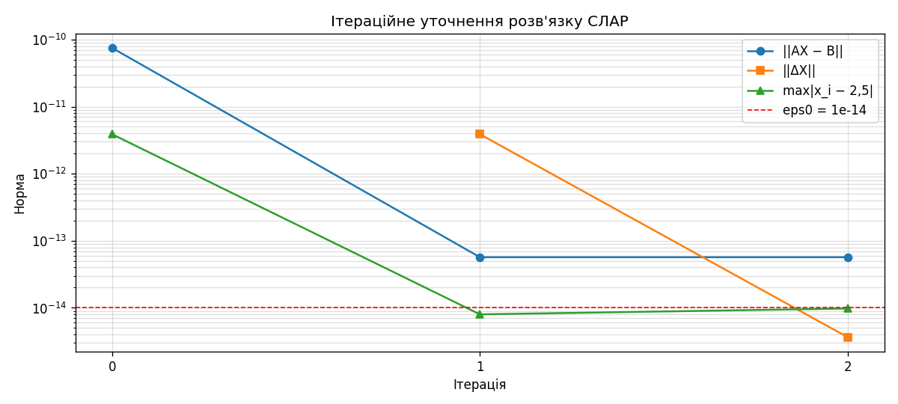

# Лабораторна робота №6

**Тема:** LU-розклад. Ітераційні методи уточнення розв'язку СЛАР

**Задача:** випадкова матриця A 100×100 (елементи з [−10; 10], seed = 2026), розв'язок xᵢ = 2.5,
bᵢ = Σ aᵢⱼxⱼ. Розв'язати AX = B за допомогою LU-розкладу (A = LU, uᵢᵢ = 1) і уточнити розв'язок
ітераційним методом з eps₀ = 1e−14.

Програма: [`main.py`](main.py), вивід — [`console_output.txt`](console_output.txt).
Файли: [`matrix_A.txt`](matrix_A.txt), [`vector_B.txt`](vector_B.txt), [`lu.txt`](lu.txt),
[`solution_X0.txt`](solution_X0.txt), [`solution_X.txt`](solution_X.txt).

## Результати

- LU-розклад: max|LU − A| = 5.65e−12, min|lₖₖ| = 0.364.
- Розв'язок за LU-розкладом: eps = max|Σaᵢⱼxⱼ − bᵢ| = 7.49e−11, max|xᵢ − 2.5| = 3.87e−12.

| Ітерація | ‖ΔX‖ | ‖AX − B‖ | max|xᵢ − 2.5| |
|----------|------|----------|---------------|
| 0 | — | 7.49e−11 | 3.87e−12 |
| 1 | 3.87e−12 | 5.68e−14 | 7.99e−15 |
| 2 | 3.65e−15 | 5.68e−14 | 9.77e−15 |

Для досягнення точності 1e−14 потрібно **2 ітерації**. Нев'язка не опускається нижче ~6e−14: при
|bᵢ| до 461 межа округлення в подвійній точності ε_m·max Σ|aᵢⱼxⱼ| ≈ 3.1e−13, тому абсолютна вимога
‖AX − B‖ ≤ 1e−14 недосяжна.

