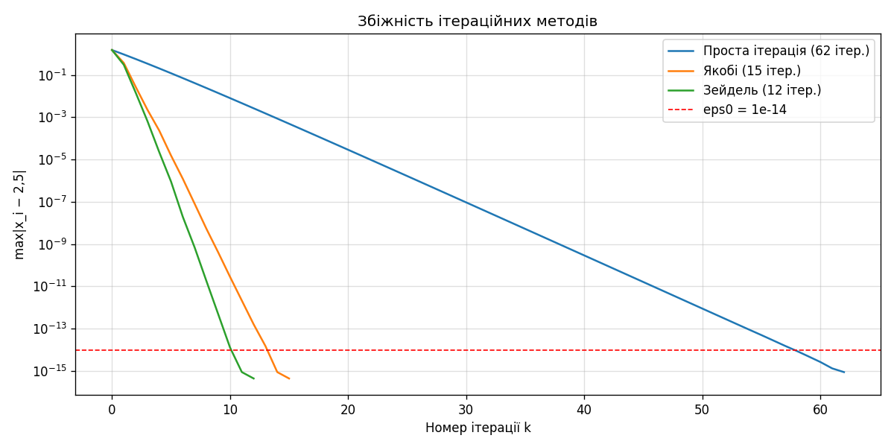

# Лабораторна робота №7

**Тема:** Ітераційні методи розв'язку систем лінійних алгебраїчних рівнянь

**Задача:** матриця A 100×100 з діагональним переважанням (aᵢⱼ ∈ [−1; 1], aᵢᵢ = 1.5·Σ|aᵢⱼ|, seed = 2026),
розв'язок xᵢ = 2.5, початкове наближення xᵢ⁽⁰⁾ = 1. Розв'язати AX = f методами простої ітерації,
Якобі та Зейделя з точністю eps₀ = 1e−14.

Програма: [`main.py`](main.py), вивід — [`console_output.txt`](console_output.txt).

## Результати

- ‖A‖ = 141.35; проста ітерація з τ = 1/‖A‖ = 0.007075 (0 < τ < 2/‖A‖), ‖C‖ = 0.853;
  Якобі: ‖C‖ = max Σ|aᵢⱼ|/|aᵢᵢ| = 0.667 < 1.

| Метод | ‖C‖ | Ітерацій | max|xᵢ − 2.5| |
|-------|-----|----------|---------------|
| Проста ітерація | 0.8533 | **62** | 8.9e−16 |
| Якобі | 0.6667 | **15** | 4.4e−16 |
| Зейдель | — | **12** | 4.4e−16 |

Швидкість збіжності визначається нормою матриці переходу C; метод Зейделя найшвидший, бо одразу
використовує оновлені компоненти розв'язку.
