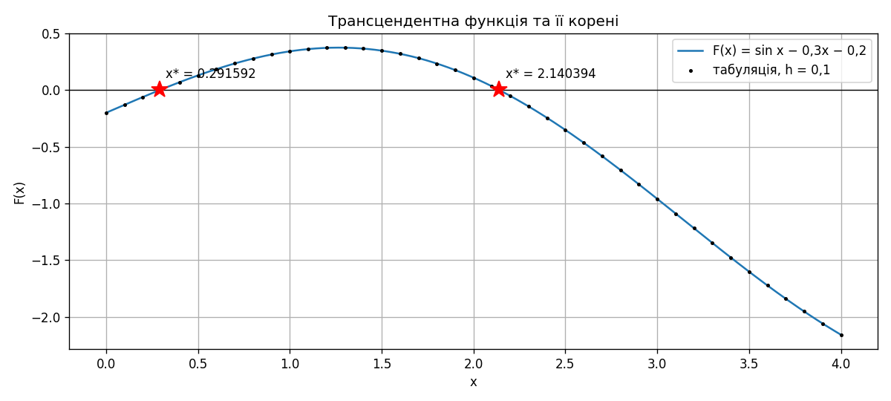
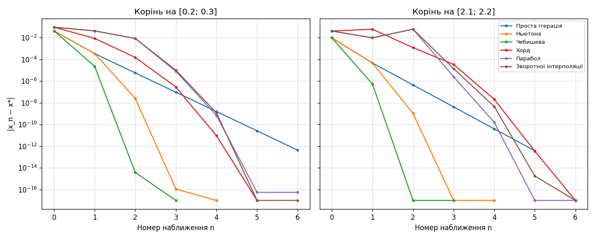
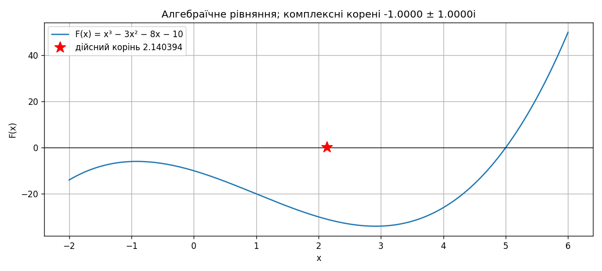

# Лабораторна робота №8

**Тема:** Чисельні методи розв'язування нелінійних рівнянь з одним невідомим

Програма: [`main.py`](main.py), вивід — [`console_output.txt`](console_output.txt),
табуляція — [`tabulation.txt`](tabulation.txt), коефіцієнти многочлена — [`poly.txt`](poly.txt).

## Трансцендентне рівняння F(x) = sin x − 0.3x − 0.2 = 0 на [0; 4]

Табуляція з кроком 0.1 дала дві зміни знаку: [0.2; 0.3] (F зростає) і [2.1; 2.2] (F спадає).
Корені: **x₁* = 0.291592324812**, **x₂* = 2.140393780114**. Кількість ітерацій для ε = 1e−10
(критерій |F(xₙ₊₁)| < ε і |xₙ₊₁ − xₙ| < ε):

| Метод | Порядок | x₁* | x₂* |
|-------|---------|-----|-----|
| Проста ітерація (τ = −1/F′(x₀)) | 1 | 6 | 5 |
| Ньютона | 2 | 4 | 4 |
| Чебишева | 3 | 3 | 3 |
| Хорд | 1.618 | 4 | 5 |
| Парабол | 1.84 | 4 | 4 |
| Зворотної інтерполяції | ≈ 1.84 | 4 | 4 |

## Алгебраїчне рівняння x³ − 3x² − 8x − 10 = (x − 5)(x² + 2x + 2) = 0

- Метод Ньютона за схемою Горнера, x₀ = 6: дійсний корінь **5** за 6 ітерацій.
- Метод Ліна, α₀ ± iβ₀ = −0.5 ± 1.5i: комплексні корені **−1 ± i** за 33 ітерації.
  Метод Ліна збігається лінійно і лише тоді, коли комплексні корені менші за модулем від інших
  (|−1 ± i| ≈ 1.41 < 5); для (x − 1.5)(x² + 2x + 5) ітерації розбігаються.

