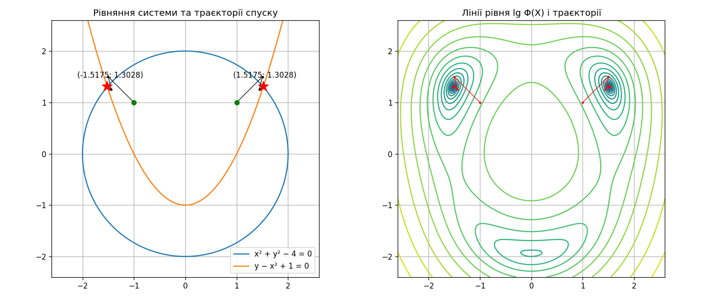
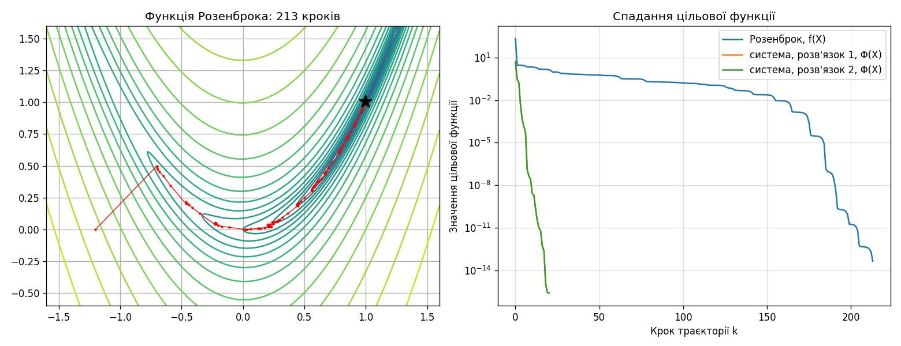

# Лабораторна робота №9

**Тема:** Метод Хука–Дживса багатовимірної оптимізації

Система нелінійних рівнянь (m = 2) зводиться до мінімізації Φ(X) = f₁² + f₂²:

- f₁(x, y) = x² + y² − 4 = 0 (коло радіуса 2),
- f₂(x, y) = y − x² + 1 = 0 (парабола y = x² − 1).

Точні розв'язки: (±1.5174899136; 1.3027756377) — з y² + y − 3 = 0.

Програма: [`main.py`](main.py), вивід — [`console_output.txt`](console_output.txt).
Траєкторії спуску: [`trajectory_system_1.txt`](trajectory_system_1.txt),
[`trajectory_system_2.txt`](trajectory_system_2.txt), [`trajectory_rosenbrock.txt`](trajectory_rosenbrock.txt).

Параметри: q = 2, p = 2, ε₁ = 1e−8, ε₂ = 1e−16, початковий крок Δxᵢ = 0.5.

| Задача | X⁽⁰⁾ | X* | Цільова функція | Кроків | Обчислень |
|--------|------|----|-----------------|--------|-----------|
| Розенброк (тест) | (−1.2; 0) | (0.99999979; 0.99999958) | 4.6e−14 | 213 | 1021 |
| Система, розв'язок 1 | (1; 1) | (1.51748992; 1.30277564) | 2.6e−16 | 20 | 237 |
| Система, розв'язок 2 | (−1; 1) | (−1.51748992; 1.30277564) | 2.6e−16 | 20 | 240 |

